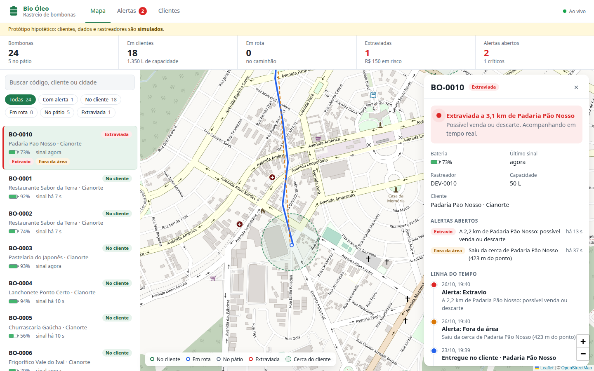
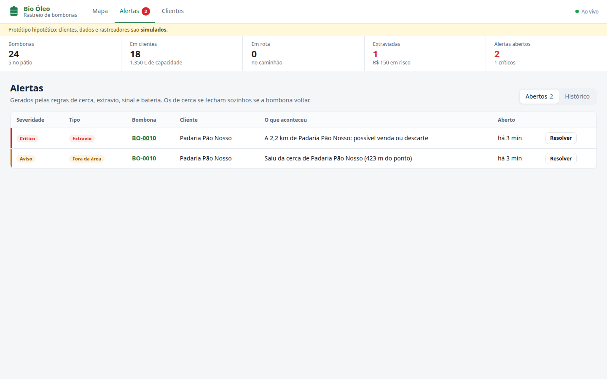

# Rastreio de Bombonas · Bio Óleo

Protótipo **hipotético** de um sistema para rastrear as bombonas que a Bio Óleo (Cianorte-PR) deixa nos
clientes para coletar óleo de cozinha usado.

## Como abrir (rápido)

> Vale também para quem pede a um agente de IA (Claude, Codex etc.) "abre o projeto no navegador".

1. **Node.js 23.6 ou mais novo** (`node -v`). Com o Node 22 o `npm install` só avisa, mas a API não sobe.
2. Clone **já na branch `feat/contratos-rotas`**, que é a versão com contratos, rotas e o player (a `main` é a
   versão antiga):

   ```bash
   git clone -b feat/contratos-rotas https://github.com/sknpz/esg-task.git
   cd esg-task
   npm install
   npm run dev
   ```

   Se já clonou, rode `git checkout feat/contratos-rotas` antes do `npm install`.
3. O `npm run dev` fica rodando (deixe o terminal aberto, ou rode em segundo plano). Quando aparecer
   `Local: http://localhost:5173/`, abra **http://localhost:5173** no navegador.
4. **A simulação nasce parada:** aperte **▶** na barra abaixo do cabeçalho para os furgões começarem a andar.
   Ela nasce também em **tempo real** (furgões a 80 km/h, um roteiro leva horas): para apresentar, aperte
   **Demo 90 s** no player.

Precisa de internet (mapa e cálculo das rotas). Detalhes em [Como rodar](#como-rodar) e
[Roteiro de demonstração](#roteiro-de-demonstração).

## O problema

Bombonas somem. O cliente vende para um sucateiro, empresta ou descarta (às vezes sem saber que a bombona
não é dele), e a empresa só descobre na hora da coleta. Isso gera prejuízo com a reposição e também perda
ambiental, porque o óleo que não é coletado tende a ir parar no esgoto.

## A proposta

Um rastreador em cada bombona, acompanhado num mapa **como o iFood acompanha o motoboy**. A diferença é que a
bombona quase sempre está parada, então o que importa é perceber quando ela **sai de onde deveria estar**:

- cada cliente tem uma **cerca virtual** em volta do endereço;
- quando a bombona sai da cerca, o sistema abre um alerta e passa a mostrar a **trilha** dela no mapa, em
  tempo real;
- se ela for longe demais, é marcada como **extraviada** e o cliente ganha um histórico de risco.

Em volta disso, a operação segue o que a Bio Óleo faz de fato: cada cliente tem um **contrato** com a frequência
da coleta, e a coleta é uma **troca** (o furgão deixa bombonas vazias e leva as cheias). O sistema tem um
calendário próprio: a cada dia simulado ele lê os contratos, divide as coletas entre os furgões e calcula a rota
de cada um, e os furgões fazem a rota no mapa.



## Limitações assumidas

- **Não temos hardware.** O dispositivo é desconhecido, então o sistema define um
  [contrato HTTP](docs/contrato-dispositivo.md) que qualquer rastreador (ou gateway) pode cumprir. Os
  dispositivos são **simulados** por um processo separado.
- **Conhecemos só parte da operação.** Vem da apresentação da Bio Óleo em aula (Aula 07): são 1.453 pontos
  atendidos, em mais de 70 municípios do PR, num raio de 250 km de Cianorte; os veículos são furgões e já
  são rastreados em tempo real; cada coleta é paga pelos litros coletados; as bombonas têm lacre com trava.
  O sumiço por venda clandestina não aparece nos slides, mas é o problema que o protótipo trabalha. As
  [regras de negócio](docs/regras-de-negocio.md), os raios, os tempos e os limites continuam **hipóteses**
  parametrizáveis, a validar com a empresa.
- Clientes, endereços e números do seed são **fictícios**.

## Arquitetura

O **servidor é o dono do relógio e das regras**: a data simulada, as fases do dia, os contratos, o planejamento
das rotas, a troca em cada parada e os alertas. O **simulador é o dono da verdade física**: sabe onde cada
bombona e cada furgão estão de fato, move tudo pelas ruas e informa ao servidor o que encontrou em cada parada
(o servidor não deduz isso, porque um rastreador mudo continua "dentro da cerca"). Cada roteiro faz **uma única
chamada ao OSRM** (pátio → paradas → pátio) para o desenho pelas ruas e a distância.

```
┌─────────────┐  POST /api/telemetria   ┌──────────────────────┐   SSE /api/eventos   ┌───────────────┐
│ Dispositivo │ ──────────────────────▶ │ API (Node + Express) │ ───────────────────▶ │ Painel (React │
│ (simulador) │   token por dispositivo │ motor de regras      │ ◀─────────────────── │  + Leaflet)   │
└─────────────┘                         │ SQLite               │     REST /api/...    └───────────────┘
                                        └──────────────────────┘
```

| Pasta        | O quê                                                                           |
|--------------|---------------------------------------------------------------------------------|
| `server/`    | API REST, recebimento de telemetria, motor de regras, eventos em tempo real     |
| `simulator/` | Imita os rastreadores: envia posição e bateria e executa cenários de desvio     |
| `web/`       | Painel do operador: mapa ao vivo, bombonas, alertas, clientes                   |
| `docs/`      | Regras de negócio, contrato do dispositivo e divisão de tarefas                 |

## Como rodar

Requisitos: **Node.js 23.6+** (o back-end roda TypeScript direto e usa o SQLite embutido no Node).

```bash
npm install
npm run dev
```

Isso sobe três processos:

| Processo   | Endereço                     |
|------------|------------------------------|
| API        | http://localhost:3333/api    |
| Painel     | http://localhost:5173        |
| Simulador  | envia leituras para a API    |

> **Rode de um clone no disco do PC, não do pendrive.** No pendrive (FAT32, sem links simbólicos) o
> `npm install` da raiz falha, porque os workspaces dependem deles. E o banco SQLite fica tão lento ali que os
> furgões andam aos pulos.

O banco (`server/data/bombonas.db`) é criado e populado na primeira execução. Para começar do zero, use o botão **⟲** do
player (apagar o arquivo com o simulador rodando reinicia a rodada em 1 e o simulador continua com os tokens antigos).

Para rodar como em produção, com a API servindo o painel já compilado:

```bash
npm run build
npm start          # API + painel em http://localhost:3333
npm run simular    # em outro terminal
```

Outros comandos:

```bash
npm test           # testes do back-end, do simulador e da barra de andamento do painel
npm run typecheck  # checagem de tipos em todos os pacotes
```

As variáveis de ambiente (tempo de sem sinal, distância de extravio etc.) estão nas
[regras de negócio](docs/regras-de-negocio.md#parâmetros) e no [README do simulador](simulator/README.md).

## Telas

| Tela         | O que mostra                                                                                     |
|--------------|---------------------------------------------------------------------------------------------------|
| **Mapa**     | Bombonas por status, cercas, trilha do percurso atual da selecionada (some quando ela sai para outro), botão de centralizar, indicadores e avisos ao vivo (alertas e etapas: entregue, chegou ao pátio, recarregada). Em rota: caminho que falta pelas ruas e previsão de chegada. O painel lateral (no celular, uma gaveta que abre e recolhe) tem a situação, as etapas do ciclo, a operação (entrega, coleta, recuperação), os controles da simulação e a linha do tempo |
| **Coletas do dia** | Data simulada, um cartão por furgão (paradas, bombonas pela capacidade, km, situação), a lista de paradas com o resultado de cada troca, as coletas não atendidas e o mapa com os furgões andando. O botão **Acompanhar** de um furgão na rua aproxima o mapa dele e vai atrás enquanto ele anda (arrastar o mapa ou **Parar de acompanhar** solta) |
| **Contratos** | Lista com frequência, quantidade e próximas coletas; cria, edita e encerra contratos. O contrato novo já vem com o dia da data de início marcado e pode cadastrar um **cliente novo** junto (nome, tipo, cidade, endereço e o local clicado num mapa, até 250 km do pátio) |
| **Alertas**  | Abertos e histórico, com resolução manual e observação                                            |
| **Clientes** | Ranking de risco pelo histórico de incidentes, com pesquisa (nome, cidade ou endereço, sem ligar para acentos), filtros por risco e por modalidade do contrato (diária, semanal, quinzenal, mensal, sem contrato) e ordenação por bombonas (clique no cabeçalho) |



## Roteiro de demonstração

> **O player.** A barra abaixo do cabeçalho controla a simulação em todas as abas: ▶/⏸ para rodar e pausar,
> **1x/2x** para a velocidade, **Tempo real | Demo 90 s** para o modo (a opção ativa fica destacada), ⟲ para voltar ao começo (pede confirmação) e
> a trilha mostra o andamento do dia (manhã, furgões na rua, fim do dia). A simulação **nasce parada e em tempo real**
> (e volta ao tempo real toda vez que o app sobe):
> os furgões andam a 80 km/h de verdade, então um roteiro de 120 km leva ~1h30 e o dia só vira quando todos voltam
> ao pátio. **Para apresentar, troque para Demo 90 s** (cada roteiro em ~90 s, qualquer que seja a distância); o 2x
> vale nos dois modos. Aperte ▶ para começar e dê **⟲ entre uma apresentação e outra** para apagar tudo e recomeçar
> na segunda-feira, dia 1, em tempo real.

> **Sobre as vendas clandestinas.** Na vida real elas são **frequentes**: é o problema que o sistema existe para
> tratar. Na demonstração o simulador as sorteia **raramente** (`SIM_VENDAS_POR_DIA`) só para não poluir a tela;
> por isso o roteiro abaixo as força com botões.

1. **Assista a um dia.** Abra o painel na aba **Coletas do dia**, troque para **Demo 90 s** e aperte ▶. A data simulada começa numa
   segunda-feira (09/11). Depois da manhã (as coletas são geradas dos contratos), 2 ou 3 furgões saem do pátio, cada um com a
   sua região, e trocam as bombonas em cada parada: veja o resultado de cada uma na lista. Um dia leva uns 2 minutos (1 minuto em 2x).
2. **Pause.** O botão ⏸ congela o relógio e os furgões (os rastreadores continuam mandando sinal). Use
   para explicar o que está na tela e continue depois.
3. **Crie um contrato com um cliente novo.** Na aba **Contratos**, aperte **Novo contrato**, digite o nome, o tipo,
   a cidade e o endereço e clique no mapa onde o cliente fica (ou use **usar cliente já cadastrado** para o cliente
   que ainda não tem contrato). Defina a quantidade e a frequência e veja as próximas datas. O contrato vale **a partir do
   próximo dia** e o cliente entra na rota do dia em que cair.
4. **Venda clandestina.** No **Mapa**, clique numa bombona **No cliente** e escolha **Cliente vendeu a bombona**:
   ela sai da cerca, abre o alerta **Fora da área**, a trilha é desenhada e, passando de 2 km, vira
   **Extraviada** (e o cliente ganha um incidente no ranking de risco).
5. **Venda com rastreador arrancado.** Na aba **Coletas do dia**, clique em **Venda com rastreador arrancado**: a bombona some sem sair da
   cerca e o rastreador fica mudo, então nenhum alerta de cerca abre (só o de sem sinal, depois de 45 s, ou 22,5 s em 2x). O
   servidor prefere uma bombona de um cliente com coleta no próximo dia. Quando o furgão chegar nesse cliente, a parada **não acha
   a bombona**, abre o extravio e o **risco do cliente sobe**: foi o único jeito de descobrir. Na venda comum do
   passo 4 a parada só confirma, porque o rastreador já tinha visto, e o incidente não conta duas vezes.
6. Escolha **Devolver ao lugar**: os alertas se fecham sozinhos. Ou registre a **recuperação** de uma bombona
   extraviada: o furgão a leva de volta ao pátio.
7. Veja o aviso **Coleta abaixo do esperado** (RN18) na tela Alertas: de vez em quando uma troca traz bem menos
   litros que a média do cliente.
8. Teste também **Cortar o sinal** (alerta de sem sinal depois de 45 s; 22,5 s em 2x) e **Bateria fraca**.

## Próximos passos (fora do protótipo)

- Validar as regras e os parâmetros com a Bio Óleo.
- Escolher o hardware (veja as opções no [contrato do dispositivo](docs/contrato-dispositivo.md)) e testar a
  bateria em campo.
- Login de operadores e perfis de acesso; hoje o painel é aberto.
- Notificações fora do painel (WhatsApp/e-mail) para alertas críticos.
- Trocar o SQLite por PostgreSQL/PostGIS se o volume de leituras crescer.

## Divisão de tarefas

Veja [docs/tasks.md](docs/tasks.md). Cada tarefa tem uma issue e um PR no GitHub.
