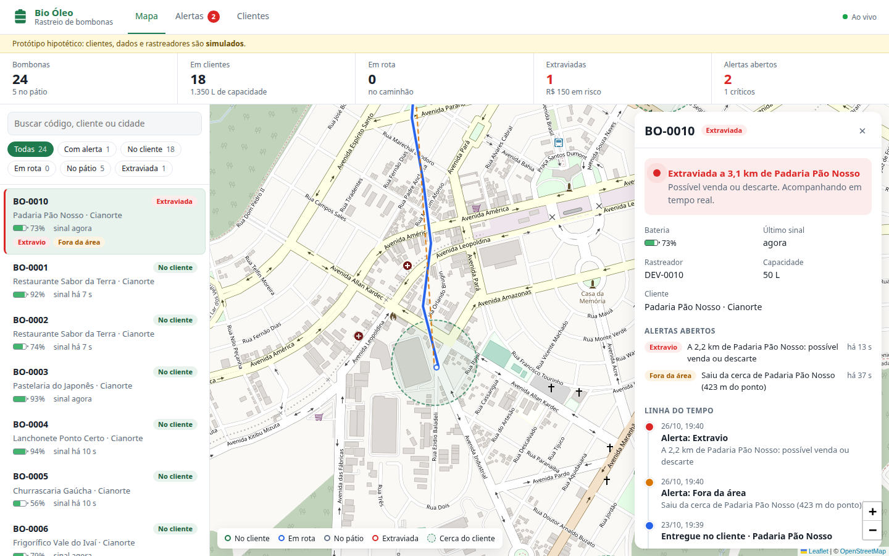
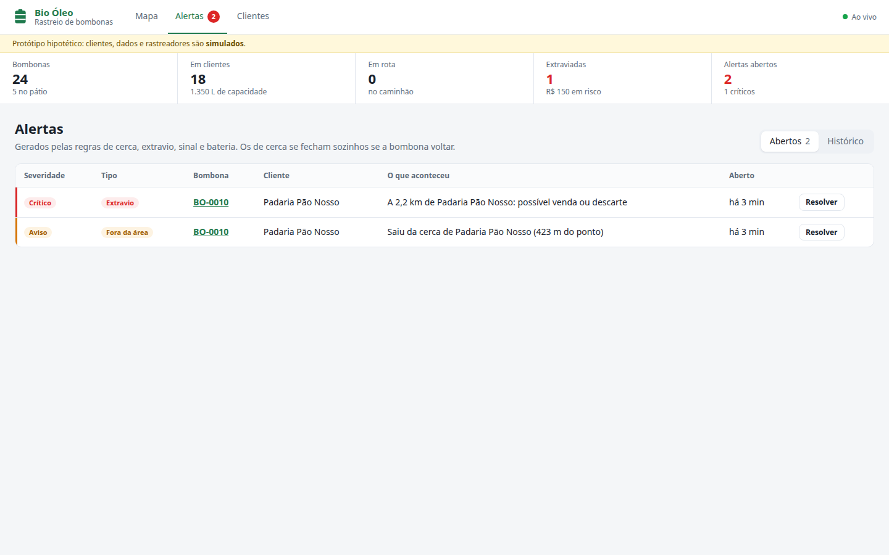

# Rastreio de Bombonas · Bio Óleo

Protótipo **hipotético** de um sistema para rastrear as bombonas que a Bio Óleo (Cianorte-PR) deixa nos
clientes para coletar óleo de cozinha usado.

## O problema

Bombonas somem. O cliente vende para um sucateiro, empresta ou descarta (às vezes sem saber que a bombona
não é dele), e a empresa só descobre na hora da coleta. Isso gera prejuízo com a reposição e também perda
ambiental, porque o óleo que não é coletado tende a ir parar no esgoto.

## A proposta

Um rastreador em cada bombona, acompanhado num mapa **como o iFood acompanha o motoboy**. A diferença é que a
bombona quase sempre está parada, então o que importa é perceber quando ela **sai de onde deveria estar**:

- cada cliente tem uma **cerca virtual** em volta do endereço;
- quando a bombona sai da cerca, o sistema abre um alerta e passa a mostrar a **trilha** dela no mapa, em
  tempo real;
- se ela for longe demais, é marcada como **extraviada** e o cliente ganha um histórico de risco.



## Limitações assumidas

- **Não temos hardware.** O dispositivo é desconhecido, então o sistema define um
  [contrato HTTP](docs/contrato-dispositivo.md) que qualquer rastreador (ou gateway) pode cumprir. Os
  dispositivos são **simulados** por um processo separado.
- **Não conhecemos as regras da empresa.** As [regras de negócio](docs/regras-de-negocio.md) são hipóteses
  documentadas e parametrizáveis.
- Clientes, endereços e números são **fictícios**.

## Arquitetura

```
┌─────────────┐  POST /api/telemetria   ┌──────────────────────┐   SSE /api/eventos   ┌───────────────┐
│ Dispositivo │ ──────────────────────▶ │ API (Node + Express) │ ───────────────────▶ │ Painel (React │
│ (simulador) │   token por dispositivo │ motor de regras      │ ◀─────────────────── │  + Leaflet)   │
└─────────────┘                         │ SQLite               │     REST /api/...    └───────────────┘
                                        └──────────────────────┘
```

| Pasta        | O quê                                                                           |
|--------------|---------------------------------------------------------------------------------|
| `server/`    | API REST, recebimento de telemetria, motor de regras, eventos em tempo real     |
| `simulator/` | Imita os rastreadores: envia posição e bateria e executa cenários de desvio     |
| `web/`       | Painel do operador: mapa ao vivo, bombonas, alertas, clientes                   |
| `docs/`      | Regras de negócio, contrato do dispositivo e divisão de tarefas                 |

## Como rodar

Requisitos: **Node.js 23.6+** (o back-end roda TypeScript direto e usa o SQLite embutido no Node).

```bash
npm install
npm run dev
```

Isso sobe três processos:

| Processo   | Endereço                     |
|------------|------------------------------|
| API        | http://localhost:3333/api    |
| Painel     | http://localhost:5173        |
| Simulador  | envia leituras para a API    |

O banco (`server/data/bombonas.db`) é criado e populado na primeira execução. Para começar do zero, apague o
arquivo.

Para rodar como em produção, com a API servindo o painel já compilado:

```bash
npm run build
npm start          # API + painel em http://localhost:3333
npm run simular    # em outro terminal
```

Outros comandos:

```bash
npm test           # testes do back-end (regras de negócio pela API)
npm run typecheck  # checagem de tipos em todos os pacotes
```

As variáveis de ambiente (tempo de sem sinal, distância de extravio etc.) estão nas
[regras de negócio](docs/regras-de-negocio.md#parâmetros) e no [README do simulador](simulator/README.md).

## Telas

| Tela         | O que mostra                                                                                     |
|--------------|---------------------------------------------------------------------------------------------------|
| **Mapa**     | Bombonas por status, cercas, trilha da selecionada, indicadores e avisos ao vivo. O painel lateral tem a situação, a operação (entrega, coleta, recuperação), os controles da simulação e a linha do tempo |
| **Alertas**  | Abertos e histórico, com resolução manual e observação                                            |
| **Clientes** | Ranking de risco pelo histórico de incidentes                                                     |



## Roteiro de demonstração

1. Abra o painel. As bombonas aparecem nos clientes, em Cianorte e nas cidades vizinhas. Duas já saem do pátio
   em rota: clique numa delas para ver o "caminhão" chegando, e a entrega se confirma sozinha.
2. Clique numa bombona **No cliente** e, em **Simulação**, escolha **Cliente vendeu a bombona**.
3. Em poucos segundos ela sai da cerca: abre o alerta **Fora da área**, chega o aviso e a trilha começa a ser
   desenhada.
4. Passando de 2 km, ela vira **Extraviada** e o cliente ganha um incidente no ranking de risco.
5. Escolha **Devolver ao lugar**: os alertas se fecham sozinhos. Ou registre a **recuperação**: o caminhão
   leva a bombona de volta ao pátio.
6. Teste também **Cortar o sinal** (alerta de sem sinal depois de 45 s) e **Bateria fraca**.

## Próximos passos (fora do protótipo)

- Validar as regras e os parâmetros com a Bio Óleo.
- Escolher o hardware (veja as opções no [contrato do dispositivo](docs/contrato-dispositivo.md)) e testar a
  bateria em campo.
- Login de operadores e perfis de acesso; hoje o painel é aberto.
- Notificações fora do painel (WhatsApp/e-mail) para alertas críticos.
- Trocar o SQLite por PostgreSQL/PostGIS se o volume de leituras crescer.

## Divisão de tarefas

Veja [docs/tasks.md](docs/tasks.md). Cada tarefa tem uma issue e um PR no GitHub.
